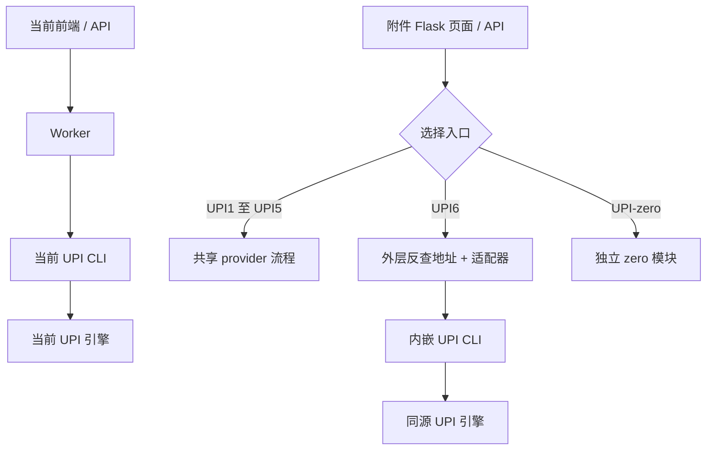

# UPI 提链源码对比：附件 pay153 与当前 tilian

本文记录核查时的本地工作区，包含未纳入本次 GitHub 提交的账单相关修改；文中的当前行为和行号属于该核查快照，不代表发布版本已包含这些修改。文末 runtime 快照仅保存在本机，未随报告上传。

对比日期：2026-10-15。范围是 UPI 入口、引擎、账单来源、调度和结果校验。

**主要结论：附件的 UPI6 导入了与你当前仓库同一提交的 UPI 引擎，再增加外围适配。附件页面默认选择的 UPI5 则走另一条共享 provider 流程。附件的编号不能直接理解为你的项目的升级版本。**

附件新增的显著能力是按代理坐标反查地址、多入口路由和位置排序；你当前项目的显著区别是独立 API/Worker 调度、五地区账单限制及可选的外部地址文件。源码不足以证明哪边真实成功率更高。

| 对比项 | 当前项目 | 附件项目 | 实际影响 |
|---|---|---|---|
| 运行接入 | FastAPI → Worker → UPI CLI | Flask → 分支路由；UPI6 再启动内嵌 CLI | 外围调度不同，不能直接覆盖整个项目 |
| 默认 UPI 路径 | 后台适配器默认 `upi-git5` | 页面默认 UPI5；UPI6 是另一可选入口 | 名称相近不代表调用同一个函数 |
| UPI6 核心关系 | 当前引擎包含本地修改 | 来源提交与当前 HEAD 相同，多数重叠文件一致 | 核心同源，但当前工作区及外围参数已分叉 |
| 地址来源 | 显式输入，或本地池；外部文件需配置 | UPI6、部分 UPI5 路径在上层按坐标反查后传入 | 附件多了地图网络依赖与缓存 |
| 内置账单范围 | 32 条、15 城、五地区 | UPI6 内嵌池 78 条、49 城、24 邦/联邦属地 | 此数量比较只针对内嵌池，不能代表附件所有来源 |
| 额外 7 条地址 | 文件已存在；配置后合并为 39 条、18 城 | 没有同样的外部文件加载机制 | 文件存在不等于已经参与提链 |
| 地址校验 | 要求五地区，检查已知城市/邦/邮编前三位对应关系 | UPI6 适配器启用外部地址信任分支，放宽上述关系校验 | 附件可接受池外城市，但校验更弱 |
| 历史“权重” | 地址行等权随机；Worker 按任务项与尝试次数分配代理 | 部分批量路径按历史成功地区对代理排序 | 这是代理位置排序，不能说每条账单都按成功率加权 |
| 并发与状态 | 数据库任务、Redis 租约、Kafka、Worker 内任务并发 | 进程内队列、任务字典、线程池 | 当前更适合把 Web 服务与执行任务分开管理；仍需压测确认容量 |
| 金额/二维码/错误 | 同源引擎已有金额判断、QR 事件、原因码与重试标记 | UPI6 保留相同主体；UPI-zero 另有交付检查 | 不能把某个分支的能力归给所有入口 |

**入口关系**

附件 UPI6 适配器实际传给内嵌 CLI 的 rail 是 `upi-git5`，并固定开启部分兼容参数；当前后台也默认选 `upi-git5`，但相关可选参数由任务决定。不能把附件入口名 `upi-git6` 原样传给当前引擎，就认为接入了附件的 UPI6。

附件共享 provider 还按上游会话类型分支，其中一支调用 `upi_oai_flow`；浏览器相关文件存在，也不代表默认 UPI5 路径必然启动浏览器。

**同源证据与具体改动**

附件 `tilian_upi6/SOURCE.md` 记录导入时间 2026-10-10，来源提交为 `8d25555472177109392758b9516bf0e7c8fc1bf5`。当前仓库 HEAD 与该值一致；来源声明还得到实际文件比较支持，但本次没有联网核验 Git 历史。

对所选 18 个重叠引擎文件进行换行归一后比较，14 个文本相同，包括 CLI、账单解析器、mandate 模块、Sentinel 模块及多个契约测试。`upi_link_service.py` 从附件版本到当前版本增加 151 行、删除 131 行；154 个顶层函数/类的 AST 相同。

相同的主体逻辑包括提链入口、金额校验、二维码解析与事件、支付状态轮询、内层重建重试和错误本地化。主要变化集中在账单接入、客户端兼容配置与请求头处理。两边外围重试及传参并不相同，因此不能据核心同源推断整体行为完全相同。

**反向地址接口及开关核实**

附件根目录的 `billing_address_resolver.py` 实现了 `https://nominatim.openstreetmap.org/reverse`；根 `app.py` 的 UPI6 路径、以及 UPI5 未预选账单时的路径有实际调用。它按坐标和国家缓存，默认 30 天 TTL，包含进程内请求间隔限制、20 秒单次超时和最多两次请求尝试。

当前 UPI 引擎的印度地址解析分支使用本地池，没有接入该反向接口。容易混淆之处是：附件内嵌的 `tilian_upi6/billing_address_resolver.py` 与当前文件一致；新反查能力在附件的根目录解析器和外层调用处。

在附件全源码及当前 UPI 相关源码中，均未发现读取 `PAY153_INDIA_REVERSE_ENABLED` 的代码。附件上述调用也没有这个条件判断。因此，单凭 `.env` 写了该变量，不能证明这两份代码受它控制；还需要另一版代码或外部启动逻辑作为证据。

地图反查返回地点，不会证明它是付款人账单地址。反查函数自身还允许邮编缺失，外层有补字段逻辑；这与完整地址认证不同。缓存与回退也意味着地址不保证每次唯一。

**你当前账单库的实际源码状态**

| 地区 | 默认有效池 | 配置现有 7 条外部地址后 |
|---|---:|---:|
| Delhi | 4 | 4 |
| Karnataka | 7 | 7 |
| Maharashtra | 10 | 14 |
| Tamil Nadu | 7 | 10 |
| West Bengal | 4 | 4 |
| 合计 | 32 | 39 |

统计静态解析了主池、共享解析器及外部 JSON，并计入地区过滤和去重。当前共享解析器中符合五地区的条目都已在主池内；附件 UPI6 解析器条目也都已在其 78 条主池内。

`data/upi_billing_addresses.json` 有 7 条完整地址。当前引擎只在 `UPI_BILLING_POOL_FILE` 指向文件时读取，并不读取每条记录的成功权重。所检查配置文件未见该变量；本次未读取运行中 Worker 的完整环境，因此只确认“支持加载”，不宣称现场已生效。

外部文件按路径在进程内缓存；已缓存的进程不会仅因同一路径内容变化自动刷新。错误文件会回退内置池，容易出现“文件已换、实际仍用旧池”的排查问题。3000 条模拟数据属于独立沙箱库，不是此默认池。

当前本地校验也有覆盖边界：它检查字段格式和已知组合，不验证真实门牌或投递能力；未覆盖的有效城市可能被拒绝。

**“成功权重”具体是什么**

附件的 `record_learned_upi_location` 保存城市、地区、邮编、成功计数，`rank_upi_proxy_pool_by_location` 在部分批量入口使用这些地区信息给代理候选排序。它与账单地址逐行抽样是两件事。

附件原包没有 `data/upi_success_regions.json`，因此无法验证其现场已经积累了多少历史数据，也不能把代码内置偏好当作成功率统计。当前 Worker 的代理分配没有接入这套历史地区排序。

**附件中需要注意的工程问题**

- UPI-zero 依赖 `upi_zero_link/data/in_pincodes.json`，原始压缩包确实没有这个文件；该分支读取空池后会报“地址库为空”。这不等于 UPI5/UPI6 都无法使用。
- UPI-zero 以邮局区域信息配合随机楼栋和门牌生成完整字符串，不能直接照文件注释称所有完整地址为“真实账单”。
- UPI-zero 的交付检查验证指引页状态并排除某个特定金额值；字段缺失或其他值仍可能通过该局部规则。它不是通用的零金额或支付成功证明，也不属于 UPI6 的新增能力。
- 附件根依赖文件未列出实际 Flask 入口所需的 Flask/Gunicorn，内嵌引擎依赖文件才有。按根 README 的安装步骤，不足以保证干净环境可直接启动。
- 附件任务队列和线程池在进程内；有文件日志也不等同于持久化队列。未做重启恢复、跨进程协调或吞吐压测。

**建议**

保留当前 API/Worker 架构更利于继续维护。若后续吸收附件功能，应按功能单独核验：优先完善地址来源、实际池数量、输入拒绝原因、任务耗时和失败阶段的可观测信息；统一链接状态与金额检查的定义，并覆盖缺失字段和未知状态。没有证据支持整体替换引擎即可提高成功率。

**验证范围与复核定位**

本次只做静态源码比较和当前本地服务的只读健康查询。`http://127.0.0.1:8010/health/ready` 返回 `distributed`，数据库、Redis、Kafka 及 1 个 Worker 均就绪；这证明当前采用独立 Worker 接入，不代表业务成功率或负载测试通过。未执行附件代码、运行附件测试或创建真实支付任务，也未修改现有提链实现。

对比快照位于 `runtime/upi-comparison-20261015-112905/`：附件 128 个普通文件，当前选取 34 个相关文件。复核时当前这 34 个文件仍与快照哈希一致。附件 SHA-256：`8d8b299634ffff974954d0b9f9401d2c02e66637046fde06245cfc0225bc834b`。见 [快照清单](../runtime/upi-comparison-20261015-112905/manifest.json) 和 [同源文件比较](../runtime/upi-comparison-20261015-112905/same-source-diff.json)。

以下文件均以快照目录为根；行号用于复核，不要求信任文件内的文字说明：

| 结论 | 证据位置 |
|---|---|
| UPI6 来源与固定 rail | `archive/tilian_upi6/SOURCE.md:3`；`archive/tilian_upi6_adapter.py:101` |
| 附件页面默认及 API 分流 | `archive/static/index.html:55`；`archive/app.py:3443`、`:4046`、`:6864` |
| 当前后台 UPI 默认 rail | `current/backend/app/engine_adapter.py:293`、`:323` |
| 实际反查调用 | `archive/app.py:3865`、`:6080`；`archive/billing_address_resolver.py:233` |
| 五地区过滤与外部文件 | `current/engines/pay153-checkout-link-main/upi_link_service.py:403`、`:496`、`:593` |
| 地址关系校验差异 | `archive/tilian_upi6/upi_link_service.py:3038`；`current/engines/pay153-checkout-link-main/upi_link_service.py:705` |
| 历史位置记录与排序调用 | `archive/app.py:1997`、`:2095`、`:7557` |
| 当前任务并发、状态与代理分配 | `current/backend/app/worker.py:137`、`:159`、`:285` |
| 共享 provider 的 OAICS 调用 | `archive/provider_checkout.py:1591` |
| Zero 缺失数据依赖及局部校验 | `archive/upi_zero_link/addresses.py:19`、`:87`；`archive/upi_zero_link/verify.py:49` |
